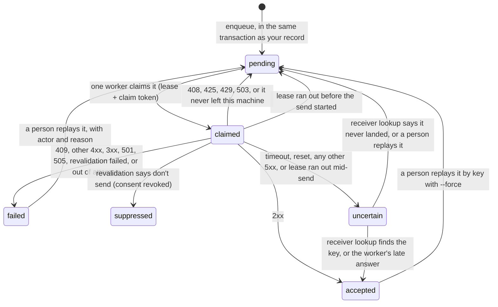

# outbox-kit

The integration layer under an internal tool. Every write the tool makes to an outside system (a CRM, an ERP, a payroll or email provider, another team's service) goes through one SQLite table:

- each write gets an **idempotency key** and is committed **in the same transaction** as the record it came from;
- one worker at a time **claims** it, with a **lease** and a **compare-and-swap** on a claim token;
- it is **signed** on the way out, and webhooks coming **in** are verified, stored once and processed in one transaction;
- it ends in a state that says what is actually known: `accepted`, `failed`, `suppressed` or **`uncertain`**.

Nothing `uncertain` is retried on a guess. A person replays it, with their name and a reason on the record, or the receiver's own record settles it.

TypeScript on Node 22.18 or later, with `node:sqlite` and no runtime dependencies. MIT. To run it from a checkout: `pnpm install`, then `pnpm test`, `pnpm demo` or `pnpm mutants`.

## Why I built this

I have hand-built pieces of this layer four times this year, each time for a small business's tool:

- **Jan 5, 2026, my company's CRM.** The phone provider's SMS delivery-receipt webhook upserted the message row, and when its phone lookup missed on formatting, it wrote `contact_id = null` over a good id. The live view filtered on `contact_id`, so delivery updates stopped appearing. The fix was to keep the existing `contact_id` and match on a normalized number.
- **Feb 26 and Aug 14, 2026, an Inglewood paralegal office's check-in kiosk.** The bilingual kiosk's first commits all land between 6 and 7 pm on Feb 26. Its CRM sync came on Aug 14: an HMAC-SHA256 signature over the body, an idempotency-key header, retry delays doubling from 1 minute up to 24 hours, and four admin actions (run the queue, replay one key, replay the failed batch, replay a date window). It keeps only the last four digits of a visitor's phone number.
- **Jul 16, 2026, OC Junk Removers' quote follow-up.** A database trigger writes the follow-up job in the same transaction that records the customer's SMS consent. A worker claims a job with a 90-second lease and an update that only succeeds if its status and attempt count are unchanged, backs off 1 min, 5 min, 15 min, 1 h, then 6 h, and fails a job for good only when re-reading the quote proves it can't be sent.
- **Sep 7, 2026, TASK.** The app stores each Square webhook with its verified signature, and a Worker replays it to the app under a 120-second lease until the app's own record says it was processed. The email worker beside it was the first of the four to say `uncertain`: a send that threw, a missing provider receipt or a claim older than 15 minutes is never retried, because, in its own comment, "a crashed invocation might have sent before its receipt was saved."

Each one had a rule another lacked. The kiosk had no claim, so two queue runs could send the same check-in, and one `failed` state meant both "try again later" and "stop". The quote outbox retries forever at 6 hours. TASK's email worker had to call every expired claim uncertain, because it couldn't tell whether the send had started. None of those four runs outbox-kit. This is the fifth time, written once with tests, so the next internal tool starts with every rule instead of the ones I remembered that week.

## What it looks like

```ts
import { createInbox, createOutbox, httpDestination, openDatabase } from "./src/index.ts";

const db = openDatabase("app.sqlite");
const outbox = createOutbox({
  db,
  destinations: {
    crm: httpDestination({ url: "https://crm.example.test/hooks/checkins", secrets: [crmSecret], timeoutMs: 10_000 }),
  },
});

// The record and its outbound write commit together, or neither does.
outbox.transaction(() => {
  db.prepare("INSERT INTO checkins (id, phone_last4, sms_consent) VALUES (?, ?, 1)").run(id, last4);
  outbox.enqueue({ destination: "crm", key: `checkin:${id}`, payload: { checkinId: id, phoneLast4: last4 } });
});

// On a timer: expire leases, then claim, sign, send and settle up to 25 jobs.
await outbox.drain();
// Ask receivers that can look a key up about jobs that are uncertain.
await outbox.reconcile();

// Webhooks in: verify against the raw body, store once per event id, then process.
const inbox = createInbox({ db, sources: { payments: { secrets: [paymentsSecret] } } });
const result = inbox.receive("payments", { headers: request.headers, body: rawBody }); // 401 if rejected
inbox.process((event, tx) => {
  const payment = event.body as { id: string; amountCents: number };
  tx.prepare("INSERT INTO payments (id, amount_cents) VALUES (?, ?)").run(payment.id, payment.amountCents);
});
```

A destination is any `send` function that returns a response, `not_sent` (provably never left) or `unknown`. `httpDestination` is the built-in one. Each destination can add `revalidate` (re-read your source of truth just before sending: fail, suppress or send), `lookup` (ask the receiver whether a key landed) and `classify` (loosen the defaults once you've proved the receiver dedupes on the key).

`pnpm demo` runs [`examples/kiosk-to-crm.ts`](examples/kiosk-to-crm.ts): four synthetic kiosk check-ins against a local CRM that answers 200, 503, a write whose response is lost, and 409. It ends with 4 records from 6 signed requests and no check-in written twice, and it fails if that changes.

## The states



`accepted` means the receiver acknowledged it, not that a person saw it. TASK's email worker put it this way: provider acceptance is not proof of delivery.

## The rules, and where each one came from

| Rule in outbox-kit | Where I learned it | What changed here |
|---|---|---|
| The outbound job commits in the same transaction as the record | OC Junk Removers: the follow-up job and the SMS consent are one transaction | An explicit `outbox.transaction()`, so it's visible in the code that writes the record; it nests in a transaction you already opened |
| One idempotency key per write, per destination | Kiosk: `x-idempotency-key` on every sync | The same key with a **different** payload throws `IdempotencyConflictError` instead of silently keeping the old one. Keys must be visible ASCII, since they travel in headers |
| Claim with a lease and a compare-and-swap | Quote outbox: 90 s lease, update guarded on status and attempt count. TASK: one `UPDATE … RETURNING` with a claim token and a 120 s lease | A `send_started_at` mark. A lease that runs out **before** the send goes back to `pending`; one that runs out **after** is `uncertain`. Only the current token can settle, and no send starts on an expired lease. A destination's timeout must be shorter than the lease |
| `uncertain` is never retried on its own | TASK email worker: a thrown send or a missing receipt settles as uncertain. The kiosk and quote outbox retried timeouts, relying on the receiver to dedupe on the key | Timeouts, resets and every 5xx except 501, 503 and 505 (so 500, 502, 504 and the rest) are uncertain by default. A refused connection or DNS failure proves nothing left, so it retries |
| Settle uncertain from evidence | TASK's replay Worker decides "processed" by reading the app's own record, not the HTTP status | Optional `lookup(key)` per destination; `reconcile()` asks only after 5 minutes and moves a job only on `applied` or `not_applied` |
| Back off, honor the receiver, then stop | Quote outbox: 1 min, 5 min, 15 min, 1 h, 6 h, then 6 h forever. Kiosk: doubling up to 24 h, forever | That ladder by default; `Retry-After` can make a wait longer, up to 24 h, never shorter; after `maxAttempts` (6) the job is `failed` with the reason |
| One state per meaning | Kiosk: one `failed` state for both "retry later" and "stop" | `pending` with a time means retry; `failed` means stop until a person acts. 409 fails for a person to resolve |
| Four replay modes, each on the record | Kiosk: run the queue, replay by key, replay the failed batch, replay a date window | `drain()`, `replay({ key })`, `replay({ state })`, `replay({ createdFrom, createdTo })`, plus `state: "uncertain"`. Every replay needs an actor and a reason, writes an audit row and can dry-run first. Suppressed jobs never replay; accepted ones only by key with `force` |
| Sign what you send | Kiosk: HMAC-SHA256 over the raw body | The message id and timestamp are inside the signature, so a captured request stops verifying after 5 minutes. It uses the Standard Webhooks header layout, checked against the `standardwebhooks` reference library in both directions, and signs with several secrets during a rotation |
| Store webhooks in, once, before processing | TASK: Square events stored with their verified signature, deduped on event id | The handler's writes and the "processed" mark commit in one SQLite transaction; a handler that throws rolls back and backs off; async handlers are refused, since their writes would land outside it |
| An inbound event never erases what you know | My company's CRM, Jan 5 | `mergeKnown(existing, incoming)`: null or missing never overwrites a known value; clearing a field must be named |
| Keep the least you need | Kiosk: last four digits of the phone only. Quote outbox: error text clipped to 240 characters | `prune()` drops payloads of accepted and suppressed jobs after a retention window and audits it (failed and uncertain ones keep theirs for replay); reasons are clipped to 240 characters; the CLI's `list` and `attempts` never print payloads |

## Admin

```console
$ pnpm -s admin status --db app.sqlite
state        jobs
pending         0
claimed         0
accepted        3
failed          1
uncertain       1   oldest since 2026-11-02T16:00:05.000Z; needs a person or a receiver lookup
suppressed      0

$ pnpm -s admin list --db app.sqlite --state uncertain
#4 crm checkin:demo-004 uncertain attempts=1 TimeoutError: The operation was aborted due to timeout

$ pnpm -s admin replay --db app.sqlite --state uncertain --actor jacob \
    --reason "CRM has no record for this key" --dry-run
dry run: would replay 1 job
  #4 crm checkin:demo-004 (was uncertain)
```

That is real output from a scratch database of five synthetic jobs. The CLI also has `attempts --destination <d> --key <k>` (every attempt and audit row for one job, never its payload), replay by key (`--force` for an accepted job) and by `--from/--to` window, and `--json` on every command.

## What was tested

`pnpm test` runs 89 tests in 9 files, on Node 22 and 24 in CI. Every test uses synthetic data.

| File | Tests | What it proves |
|---|---|---|
| `test/outbox.test.ts` | 23 | Rollback leaves neither record nor job; key and payload conflicts; ladder and `Retry-After`; stops at `maxAttempts`; uncertain untouched across 30 simulated days; leases expiring before and after the send starts; a late answer is kept, but not after a replay hands the job to a new worker; revalidation; `reconcile`; WAL with `synchronous=FULL` |
| `test/classify.test.ts` | 28 | What each HTTP status and transport outcome proves; `Retry-After` in seconds and dates; the ladder; canonical JSON |
| `test/replay.test.ts` | 8 | Each replay mode, dry run, force, suppressed never replays, audit rows, prune |
| `test/inbox.test.ts` | 7 | Verify, dedupe, transactional processing, rollback and backoff, async handlers refused, the Jan 5 null-overwrite replayed with and without `mergeKnown` |
| `test/signing.test.ts` | 9 | Tampering, the 5-minute window, raw versus re-serialized bodies, rotation, a mistyped secret refused, interop with `standardwebhooks@1.1.1` both ways |
| `test/http.test.ts` | 6 | A real local receiver: signatures verified on the wire; 503 with `Retry-After`; a timeout becomes uncertain **and the receiver did get the request**; a refused connection retries; redirects aren't followed |
| `test/processes.test.ts` | 1 | 4 separate OS processes drain 200 jobs from one SQLite file: every key is sent exactly once and accepted. The split per process is printed as a test diagnostic |
| `test/cli.test.ts` | 5 | `status`, `list`, `attempts`, replay by state, window and key, and exit codes |
| `test/locking.test.ts` | 2 | Another process holds the write lock past SQLite's busy timeout: a transaction waits and then commits instead of failing, a shorter wait still gives up, and an error that isn't a busy lock is raised at once |

`pnpm mutants` breaks 14 rules one at a time in a scratch copy (for example: let uncertain jobs be claimed, drop the claim-token check, retry 500s, stop signing the timestamp) and fails unless the suite catches every one. It first requires the unmutated suite to pass. Today it catches 14 of 14. CI also runs `pnpm typecheck` (strict), `pnpm demo` and the CLI.

Not measured here: throughput, latency or behaviour under load. The multi-process test shows correctness under contention, not speed. Nothing in this repo has run in production.

## When to use something else

- **One outside API, called once, that already takes an `Idempotency-Key`** and can fail the user's request when it's down: call it directly. An outbox earns its keep when the write must survive the receiver being down.
- **A workflow engine or a managed queue with dead-letter handling is already running**: put these rules there instead of adding a second queue.
- **The integration is a weekly spreadsheet someone emails**: fix the process before writing software.
- **Many writers across services, or Postgres**: v0.1 is SQLite only. The same claims map to `UPDATE … WHERE id = (SELECT … FOR UPDATE SKIP LOCKED) RETURNING`, but that adapter isn't written or tested yet.

It fits one internal app with its own database, a few outside systems, and an admin who has to answer "did it go through?" from a record instead of the logs. Today that record is read through the CLI; `status()`, `list()`, `attempts()` and `replay()` are the calls an admin page inside the tool would make, and that page isn't built.

## Limits

- SQLite through `node:sqlite`, which Node still marks experimental. One database file; WAL with `synchronous=FULL` and a 5-second busy timeout. A transaction that still finds the write lock taken retries with backoff for up to 30 seconds (`LOCK_WAIT_MS`), then fails. Before this, one of four workers under heavy CPU load crashed with `database is locked` in the 200-job process test.
- Nothing runs on its own: call `drain()` and `reconcile()` from a timer or cron.
- Payloads stay in the table until `prune()`. Send references and minimal fields, not whole records.
- It runs from a checkout (Node runs the TypeScript directly). It isn't on npm yet.

## License

MIT. See [LICENSE](LICENSE).
